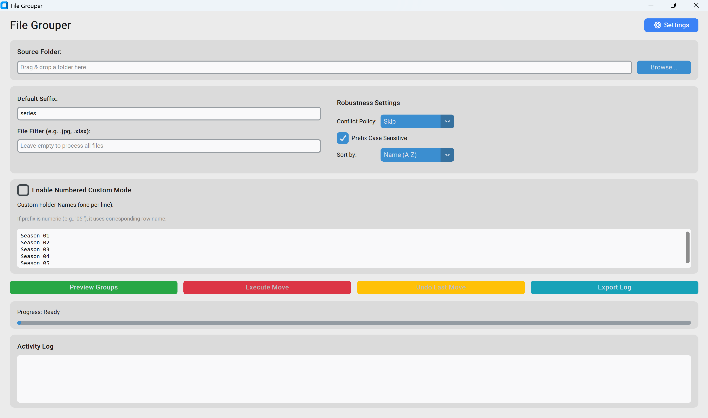

# prefix-file-sort


A smart file grouping tool that automatically organizes files into folders based on their filename prefixes. Perfect for sorting TV series episodes, numbered documents, or any files with consistent naming patterns.

> **📥 Download Standalone Executable (Windows)**:  
> Download the latest ready-to-run binary from [GitHub Releases](https://github.com/keyenhuang/prefix-file-sort/releases) (`prefix-file-sort-windows.zip`). No Python installation required!

## ✨ Features

- **🔍 Smart Prefix Detection**: Automatically extracts and groups files by their filename prefix (text before the first `-`)
- **👁️ Real-time Preview**: Preview grouping results before executing any file operations
- **↩️ Safe Undo**: Instantly undo the last batch of file moves with one click
- **⚡ Multi-threaded**: Responsive UI that won't freeze during large batch operations
- **🎯 Flexible Filtering**: Filter files by extension (e.g., `.mp4`, `.jpg, .png`)
- **🔀 Multiple Sort Modes**: Order groups by name, natural order, modification time, or file size
- **🔄 Conflict Handling**: Choose how to handle naming conflicts (Skip, Overwrite, Auto-Rename)
- **📁 Drag & Drop**: Drag folders directly into the application (when tkinterdnd2 is installed)
- **🎨 Themes & Languages**: Built-in light/dark themes and English / 中文 interface
- **📋 Activity Log**: Track all file operations with detailed logging

## 📸 Screenshots

<p align="center">
  
</p>

## 🚀 Quick Start

### Prerequisites
- Python 3.8 or higher
- tkinter (usually included with Python)

### Installation

1. Clone the repository:
```bash
git clone https://github.com/keyenhuang/prefix-file-sort.git
cd prefix-file-sort
```

2. Install dependencies (optional, for drag & drop support):
```bash
pip install -r requirements.txt
```

3. Run the application:
```bash
python main.py
```

## 📖 Usage

### Basic Usage

1. Click **Browse** to select a folder containing your files
2. Set the **Default Suffix** for created folders (e.g., `series`, `episode`)
3. Optionally, set a **File Filter** to only process specific file types
4. Click **Preview Groups** to see how files will be organized
5. Click **Execute Move** to perform the actual file grouping

### Example

Given files in a folder:
```
01-S01E01.mkv
01-S01E02.mkv
02-S02E01.mkv
02-S02E02.mkv
03-S03E01.mkv
```

After running with suffix `- episodes`:
```
├── 01 - episodes/
│   ├── 01-S01E01.mkv
│   └── 01-S01E02.mkv
├── 02 - episodes/
│   ├── 02-S02E01.mkv
│   └── 02-S02E02.mkv
└── 03 - episodes/
    └── 03-S03E01.mkv
```

### Numbered Custom Mode

Enable **Numbered Custom Mode** and provide custom names:
```
01 - First Season
02 - Second Season
03 - Third Season
```

The app will use these names instead of the default naming pattern.

### Conflict Policies

| Policy | Behavior |
|--------|----------|
| **Skip** | Skip files that would cause conflicts (default) |
| **Overwrite** | Replace existing files with the same name |
| **Auto-Rename** | Rename new files to avoid conflicts (e.g., `file (1).txt`) |

### Sort Modes

Choose how groups are ordered via the **Sort by** dropdown (in Robustness Settings):

| Mode | Behavior |
|------|----------|
| **Name (A-Z)** | Alphabetical by prefix (default) |
| **Natural order** | Numeric-aware ordering: `2` before `10` |
| **Newest first** / **Oldest first** | By the newest/oldest file's modification time in each group |
| **Largest first** / **Smallest first** | By total file size of each group |

## 🔧 Configuration

### File Filter Syntax

Separate multiple extensions with commas:
- `.mp4` - Only process MP4 files
- `.jpg, .png, .gif` - Process image files
- Leave empty - Process all files

### Case Sensitivity

Enable **Prefix Case Sensitive** to treat `Episode` and `episode` as different prefixes.

## 🛠️ Development

### Running from Source

```bash
# Install dependencies
pip install -r requirements.txt

# Run the application
python main.py
```

### Testing & Linting

```bash
# Run the test suite (headless, no GUI required)
python run_tests.py

# Lint with ruff
pip install ruff
ruff check .
```

### Project Structure

```
prefix-file-sort/
├── main.py                # GUI application (tkinter) — entry point
├── core.py                # Core grouping/move/undo logic (tkinter-free, unit-tested)
├── i18n.py                # Internationalization (English / 中文)
├── themes.py              # Light / dark theme manager
├── tests/                 # Unit & integration tests
├── run_tests.py           # Test runner
├── prefix_file_sort.spec  # PyInstaller spec for building a Windows .exe
├── build.bat              # Windows build helper
├── requirements.txt       # Python dependencies
├── pyproject.toml         # Project metadata & ruff lint config
├── .github/               # CI workflows & issue/PR templates
├── README.md              # This file
├── LICENSE                # MIT License
├── CONTRIBUTING.md        # Contribution guidelines
├── CODE_OF_CONDUCT.md     # Community code of conduct
├── SECURITY.md            # Vulnerability reporting policy
└── CHANGELOG.md           # Version history
```

## 📝 License

This project is licensed under the MIT License - see the [LICENSE](LICENSE) file for details.

## 🤝 Contributing

Contributions are welcome! Please read our [Contributing Guide](CONTRIBUTING.md) for details on how to submit pull requests. By participating, you agree to abide by the [Code of Conduct](CODE_OF_CONDUCT.md).

## 🔒 Security

Found a vulnerability? Please see [SECURITY.md](SECURITY.md) for private reporting instructions — do not open a public issue.

## 📜 Changelog

See [CHANGELOG.md](CHANGELOG.md) for version history.

## 👤 Author

**Keyen Huang**  
- GitHub: [@keyenhuang](https://github.com/keyenhuang)

## 🙏 Acknowledgments

- Built with Python's tkinter library
- Drag & drop support via [tkinterdnd2](https://pypi.org/project/tkinterdnd2/)
